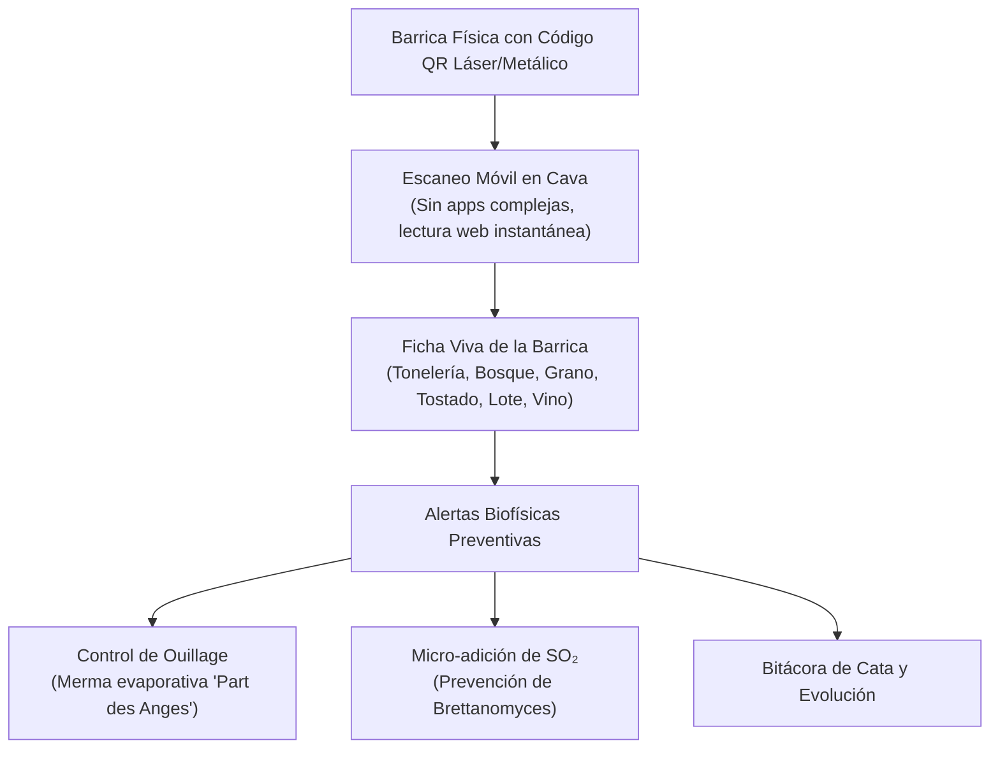

# 🪵 Smart Barrel Copilot · Intelligent Oak Aging & QR Traceability

[](https://www.python.org/)
[](https://opensource.org/licenses/MIT)
[-brightgreen.svg)]()
[]()
[]()

> **Sistema inteligente de gestión, trazabilidad por código QR y modelado de merma evaporativa (*ouillage*) para parques de barricas en bodegas vitivinícolas de alta gama.**  
> Desarrollado por **Cristián González Huenchún** (Ingeniero Agrónomo y Estudiante de Magíster en Enología y Viticultura, Universidad de Chile).  
> Validado con protocolos de manejo de crianza en roble de **Viña VIK** y **Viña El Principal**.

---

## 🌟 El Dolor Operativo en Bodega & La Solución

En bodegas boutique y de gran volumen (500 a 5.000 barricas de roble), el manejo de la crianza enfrenta desafíos críticos:



### 1. Control de Relleno (*Ouillage*) y Prevención de Picado Acético
El roble es un material poroso vivo. La transpiración de agua y etanol a través de las duelas genera una merma continua ("la parte de los ángeles"). Si una barrica acumula una cámara de aire por olvido, las bacterias acéticas (*Acetobacter aceti*) proliferan, disparando la acidez volátil (acetato de etilo).  
**Smart Barrel Copilot** modela la cinética de evaporación en función de la temperatura (°C) y humedad relativa (% HR) de la cava, alertando con precisión quirúrgica cuándo cada barrica debe ser rellenada.

### 2. Trazabilidad de Madera & Año de Uso
Diferencia y monitorea el aporte sensorial según tonelería (**Taransaud, Seguin Moreau, Radoux, Sylvain, François Frères**), bosque (**Allier, Tronçais, Vosges, Roble Americano**), nivel de tostado (**L, M, M+, H**) y número de usos (1er uso / nueva vs 2do y 3er uso).

### 3. Micro-dosificación de $SO_2$ y Protección contra *Brettanomyces*
Calcula la micro-adición exacta de metabisulfito de potasio en polvo o solución de bisulfito al 5% para cada barrica individual según su pH y volumen, asegurando el umbral de $SO_2$ molecular antiséptico.

---

## 🖥️ Interfaz Visual Apple-Style (`localhost:8070`)

El repositorio incluye una consola visual interactiva inspirada en la estética minimalista y *dark glass* de Apple:

```
smart-barrel-management/
├── dashboard/
│   ├── index.html          # Interfaz visual interactiva Apple-Style (2D Cellar Rack)
│   └── server.py           # Servidor local zero-dependency (http.server)
└── Abrir_Dashboard.bat     # Lanzador de 1 clic para Windows
```

### Características del Dashboard:
- **Mapa 2D de la Cava (36 Barricas):** Representación visual interactiva organizada por naves (Rack A y Rack B) en 3 niveles de altura, con indicadores LED de estado (🟢 Óptima, 🟡 Requiere Ouillage, 🔴 Alerta SO₂ Bajo).
- **Ficha Viva Lateral con Código QR:** Inspecciona al instante cualquier barrica con su código QR vectorial renderizado, ficha de tonelería, lote de vino y botones de acción rápida (*Registrar Relleno*, *Micro-adición de SO₂*, *Imprimir Etiqueta*).
- **Simulador Microclimático de Cava:** Sliders de temperatura y humedad para proyectar la merma mensual de la bodega completa en litros y costos.

### Cómo abrir el Dashboard Visual:
1. **Doble Clic:** Ejecuta `Abrir_Dashboard.bat` en Windows. Abre automáticamente tu navegador en `http://localhost:8070/index.html`.
2. **Terminal:**
   ```bash
   python dashboard/server.py
   ```

---

## 💻 Uso como Librería Python

```python
from barrel_copilot import (
    CellarDatabase,
    calcular_tasa_evaporacion,
    calcular_necesidad_ouillage,
    calcular_microadicion_so2_barrica,
    generar_codigo_qr_svg
)

# 1. Conectar a la base de datos de la cava
db = CellarDatabase()
barricas = db.obtener_todas()
print(f"Total de barricas activas en cava: {len(barricas)}")

# 2. Evaluar evaporación en cava a 15.5°C y 75% HR
tasa = calcular_tasa_evaporacion(temperatura_c=15.5, humedad_relativa_pct=75.0, capacidad_barrica_l=225.0)
print(f"Tasa de merma diaria: {tasa['ml_por_dia']} mL/día ({tasa['litros_por_mes']} L/mes)")

# 3. Evaluar urgencia de ouillage tras 26 días sin relleno
diagnostico = calcular_necesidad_ouillage(dias_desde_ultimo_ouillage=26, temperatura_c=15.5, humedad_relativa_pct=75.0)
print(f"Urgencia: {diagnostico['urgencia']} | Merma: {diagnostico['merma_acumulada_litros']} L")

# 4. Micro-dosificación de SO2 para barrica de 225L
orden_so2 = calcular_microadicion_so2_barrica(
    capacidad_l=225.0,
    so2_libre_actual_mg_l=18.0,
    so2_libre_objetivo_mg_l=32.0,
    ph=3.62
)
print(f"K2S2O5 requerido: {orden_so2['gramos_k2s2o5_polvo']} g")
print(f"Solución bisulfito 5%: {orden_so2['ml_solucion_bisulfito_5pct']} mL")

# 5. Generar código QR vectorial SVG
qr_svg = generar_codigo_qr_svg("BAR-2026-005")
```

---

## 🧪 Pruebas Unitarias Automatizadas

```bash
# Con la librería estándar de Python (zero dependencies):
python -m unittest tests/test_barrels.py
```

Resultado verificado:
```
.......
----------------------------------------------------------------------
Ran 7 tests in 0.020s

OK
```

---

## 📂 Arquitectura del Repositorio

```
smart-barrel-management/
├── barrel_copilot/             # Paquete modular central
│   ├── __init__.py             # Exports y versionamiento
│   ├── models.py               # Dataclass Barrica, Tonelería, Bosque y Estados
│   ├── ouillage.py             # Modelado físico de evaporación y programa de relleno
│   ├── so2_safety.py           # Microadiciones de sulfuroso y control de Brettanomyces
│   ├── qr_service.py           # Generación de códigos QR vectoriales y URLs de inspección
│   └── database.py             # Capa SQLite con dataset precargado de 36 barricas
├── dashboard/                  # Cellar Visual Cockpit
│   ├── index.html              # Frontend Apple-Style (2D Cellar Rack & Drawer)
│   └── server.py               # Servidor local Python
├── tests/                      # Suite de validación
│   └── test_barrels.py         # Pruebas unitarias completas
├── Abrir_Dashboard.bat         # Lanzador 1-clic para Windows
├── subir_a_github.bat          # Sincronizador automático con GitHub
├── LICENSE                     # Licencia MIT
└── README.md                   # Documentación técnica
```

---

## 👤 Autor

**Cristián González Huenchún**  
- Ingeniero Agrónomo · Universidad de Chile
- Estudiante de Magíster en Enología y Viticultura · Universidad de Chile
- Experiencia de Terreno: Viña VIK (Vendimia 2026) & Viña El Principal (Vendimia 2025)
- 2º Lugar · VIK Wine Lab 3 (2025)
- [LinkedIn](https://linkedin.com/in/cristian-ignacio-gonzalez-huenchun) · [GitHub](https://github.com/crisgonzalezhWineMaker)
