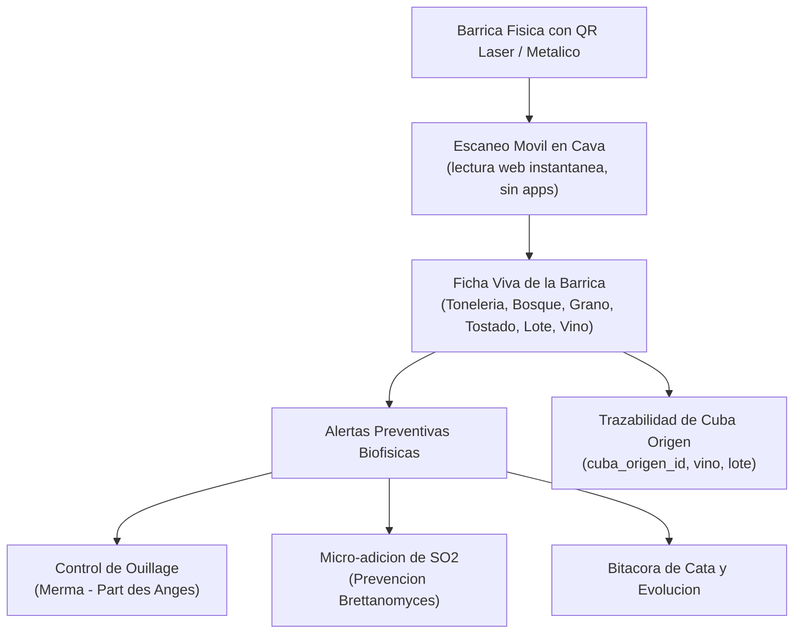

# Smart Barrel Copilot · Intelligent Oak Aging & QR Traceability

[](https://www.python.org/)
[](https://opensource.org/licenses/MIT)
[-brightgreen.svg)]()
[]()
[]()
[]()

> **Sistema inteligente de gestión, trazabilidad por código QR y modelado de merma evaporativa (*ouillage*) para parques de barricas en bodegas vitivinícolas de alta gama.**
> Desarrollado por **Cristián González Huenchún** — Ingeniero Agrónomo & Magíster (c) Enología y Viticultura, Universidad de Chile.
> Validado con protocolos de crianza en roble de **Viña VIK** y **Viña El Principal**.

---

## El Problema que Resuelve

En bodegas con 500 a 5.000 barricas de roble, el manejo de crianza enfrenta desafíos operativos críticos:



---

## Fundamentos Enológicos

### 1. Cinética de Merma Evaporativa (*Ouillage*)

El roble es poroso y transpira agua y etanol continuamente. Si la cámara de aire acumula espacio, *Acetobacter aceti* prolifera disparando la acidez volátil:

$$\text{Merma}\ (mL/día) = f(T°C,\ HR\%) \times V_{barrica}\ (L)$$

**Smart Barrel Copilot** proyecta la merma individual de cada barrica y genera alarmas de ouillage con precisión quirúrgica antes de que la cámara de aire sea crítica.

### 2. Micro-dosificación de $SO_2$ por Barrica

$$\Delta SO_2\ (mg/L) = SO_{2\ objetivo} - SO_{2\ actual}$$
$$K_2S_2O_5\ (g) = \frac{\Delta SO_2 \times V_{barrica}\ (L)}{1000 \times 0.57}$$

Calculado individualmente según pH y volumen real de cada unidad.

### 3. Trazabilidad de Cuba de Origen

Cada barrica registra el tanque o cuba de origen (`cuba_origen_id`), la cuba nodriza de relleno (`cuba_relleno_nodriza`) y el tipo de vino de relleno (`tipo_vino_relleno`), garantizando coherencia organoléptica durante toda la crianza.

---

## Dashboard Visual · Apple-Style (`localhost:8070`)

Cellar Visual Cockpit con diseño *dark glass*, mapa 2D interactivo de la cava organizado en racks y niveles, fichas vivas con QR vectorial y simulador microclimático. **Sin dependencias externas.**

### Inicio rápido (Windows)

```
Doble clic en: Abrir_Dashboard.bat
```

El servidor arranca en `http://localhost:8070/index.html` y el navegador se abre automáticamente.

### Inicio desde terminal

```bash
python dashboard/server.py
```

### Módulos del Cockpit

| Módulo | Descripción |
|---|---|
| **Mapa 2D de la Cava** | Racks A y B en 3 niveles de altura con indicadores LED de estado |
| **Ficha Viva + QR Vectorial** | Tonelería, bosque, grano, tostado, cuba origen, vino, lote |
| **Trazabilidad Completa** | `cuba_origen_id`, `cuba_relleno_nodriza`, `tipo_vino_relleno` |
| **Ouillage Interactivo** | Diálogo de relleno con registro de fecha, volumen y fuente |
| **Micro-adición de SO₂** | Cálculo automatizado K₂S₂O₅ (polvo) y bisulfito 5% (mL) |
| **Barrel Creator** | Modal para agregar barricas nuevas a la cava |
| **Simulador Microclimático** | Sliders de T°C y HR% para proyectar merma mensual total |
| **Light / Dark Mode** | Toggle de tema con persistencia `localStorage` |

---

## Instalación

```bash
# Clonar el repositorio
git clone https://github.com/crisgonzalezhWineMaker/smart-barrel-management.git
cd smart-barrel-management

# El dashboard y la librería Python funcionan con dependencias mínimas
pip install -r requirements.txt
```

**Requisitos mínimos:** Python 3.9+ · Navegador web moderno

---

## Uso como Librería Python

```python
from barrel_copilot import (
    CellarDatabase,
    calcular_tasa_evaporacion,
    calcular_necesidad_ouillage,
    calcular_microadicion_so2_barrica,
    generar_codigo_qr_svg
)

# Conectar a la base de datos de la cava (SQLite local)
db = CellarDatabase()
barricas = db.obtener_todas()
print(f"Total de barricas activas: {len(barricas)}")

# Evaporacion en cava a 15.5°C y 75% HR
tasa = calcular_tasa_evaporacion(temperatura_c=15.5, humedad_relativa_pct=75.0, capacidad_barrica_l=225.0)
print(f"Merma diaria: {tasa['ml_por_dia']} mL/dia  ({tasa['litros_por_mes']} L/mes)")

# Urgencia de ouillage tras 26 dias sin relleno
diag = calcular_necesidad_ouillage(dias_desde_ultimo_ouillage=26, temperatura_c=15.5, humedad_relativa_pct=75.0)
print(f"Urgencia: {diag['urgencia']}  |  Merma acumulada: {diag['merma_acumulada_litros']} L")

# Micro-dosificacion de SO2 para barrica de 225 L
orden_so2 = calcular_microadicion_so2_barrica(
    capacidad_l=225.0,
    so2_libre_actual_mg_l=18.0,
    so2_libre_objetivo_mg_l=32.0,
    ph=3.62
)
print(f"K2S2O5 polvo:       {orden_so2['gramos_k2s2o5_polvo']} g")
print(f"Bisulfito 5%:       {orden_so2['ml_solucion_bisulfito_5pct']} mL")

# QR vectorial SVG para etiqueta fisica
qr_svg = generar_codigo_qr_svg("BAR-2026-005")
```

---

## Suite de Tests

```bash
python -m unittest tests/test_barrels.py -v
```

```
.......
----------------------------------------------------------------------
Ran 7 tests in 0.020s  OK
```

---

## Arquitectura del Repositorio

```
smart-barrel-management/
├── barrel_copilot/             # Paquete modular central
│   ├── __init__.py             # Exports y version
│   ├── models.py               # Dataclass Barrica con trazabilidad completa
│   ├── ouillage.py             # Modelado fisico de evaporacion y programa de relleno
│   ├── so2_safety.py           # Microadiciones de SO2 y control Brettanomyces
│   ├── qr_service.py           # Codigos QR vectoriales SVG
│   └── database.py             # SQLite con 36 barricas precargadas + migracion defensiva
├── dashboard/                  # Cellar Visual Cockpit
│   ├── index.html              # Frontend Apple-Style · Dark Glass & 2D Cellar Rack
│   └── server.py               # Servidor HTTP local Python (http.server)
├── tests/
│   └── test_barrels.py         # 7 pruebas unitarias con unittest
├── Abrir_Dashboard.bat         # Lanzador 1-clic Windows
├── requirements.txt            # qrcode + dependencias opcionales
├── LICENSE                     # MIT
└── README.md
```

---

## Compatibilidad de Tonelerías

| Tonelería | País | Bosques disponibles |
|---|---|---|
| Taransaud | Francia | Allier, Tronçais, Vosges |
| Seguin Moreau | Francia | Allier, Nevers |
| Radoux | Francia | Allier, Centre France |
| Sylvain | Francia | Allier, Massif Central |
| François Frères | Francia | Tronçais, Jupilles |
| Genérica Americana | EE.UU. | Roble Americano (Quercus alba) |

---

## Autor

**Cristián González Huenchún**
- Ingeniero Agrónomo · Universidad de Chile
- Magíster (c) Enología y Viticultura · Universidad de Chile
- Asistente de Enología · Viña VIK, Vendimia 2026
- Ayudante de Bodega · Viña El Principal, Vendimia 2025
- 2º Lugar Nacional · VIK Wine Lab 3 (2025)

[](https://linkedin.com/in/cristian-ignacio-gonzalez-huenchun)
[](https://github.com/crisgonzalezhWineMaker)
